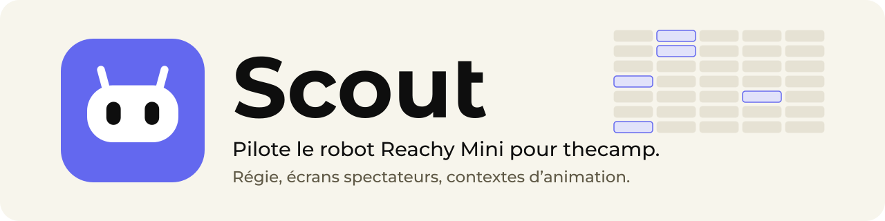
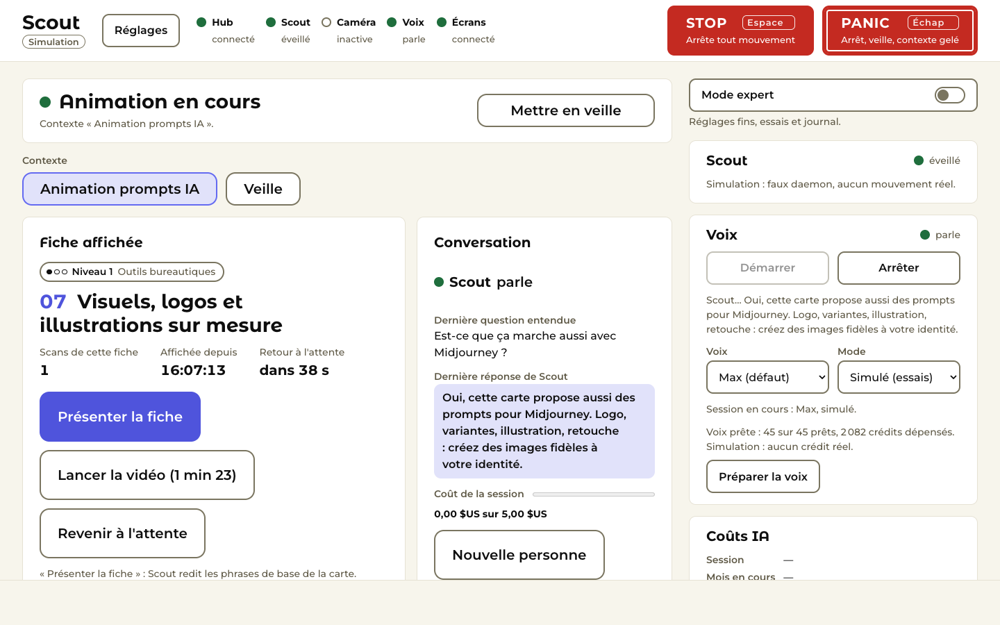
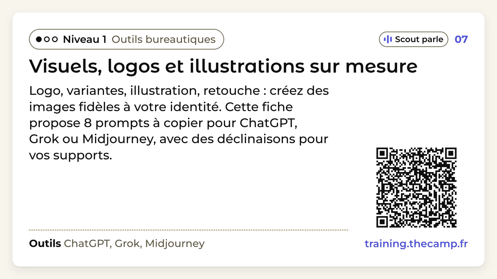
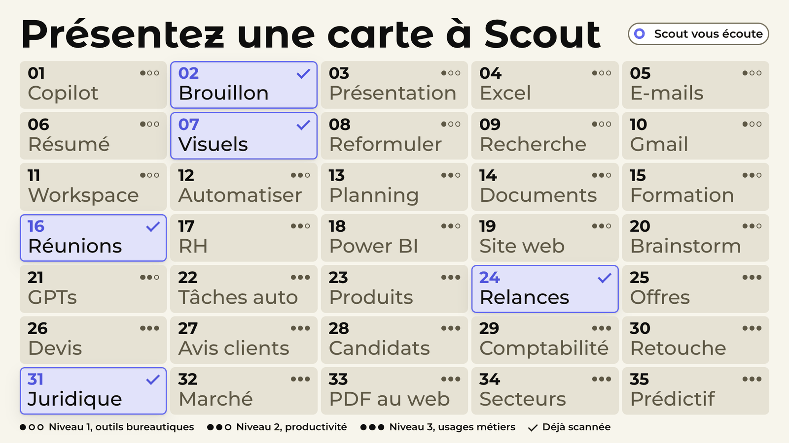

  <picture>
    <source media="(prefers-color-scheme: dark)" srcset="assets/banner-dark.svg">
    <source media="(prefers-color-scheme: light)" srcset="assets/banner-light.svg">
    
  </picture>

Scout pilote le robot Reachy Mini de thecamp : une régie pour l'opérateur et des écrans spectateurs synchronisés, avec un contexte d'activité à la fois. Le premier contexte, « Animation prompts IA », fait réagir le robot quand un visiteur lui montre l'une des 35 cartes à QR code : l'écran affiche la fiche, puis Scout converse sur le sujet.

  

  
  

Captures prises en simulation, sans robot.

## Ce que fait Scout

- **Autonome** : Scout installe et surveille lui-même le pilote du robot ; aucune autre application ni commande.
- **Vivant** : au repos, le robot respire, regarde autour de lui et se tourne vers la voix qui lui parle.
- **Conversation** : réponses courtes et chaleureuses, recherche web pour l'actualité avec des garde-fous, et la carte
  dont on parle s'affiche à l'écran quand on la demande à voix haute.
- **Robuste** : robot débranché, pilote arrêté, réseau coupé : la régie le dit clairement et Scout reprend seul.

## Télécharger

Dernière version : [page Releases](https://github.com/Nyvek4/scout-releases/releases/latest).

- `Scout-macos-arm64-<sha7>.zip` : macOS 14 ou plus récent, Apple Silicon. Signée Developer ID et notarisée par Apple.
- `Scout-windows-x64-<sha7>.zip` : Windows 10 ou 11, 64 bits, dossier portable. Non signé.
- `SHA256SUMS.txt` : empreintes des deux archives.

## Installer

- **Mac** : dézipper, glisser `Scout.app` dans Applications, l'ouvrir. Accepter les demandes caméra et micro au premier usage.
- **Windows** : dézipper **tout** le dossier en local et lancer `Scout.exe` sans le sortir du dossier. SmartScreen avertit au premier lancement : « Informations complémentaires », puis « Exécuter quand même ».
- **Premier lancement**, robot branché en USB : Scout installe seul le pilote du robot (Internet nécessaire, environ 5 minutes la toute première fois, puis quelques secondes). Aucune autre application ni commande n'est nécessaire.
- **Clés** : ouvrir « Réglages » et saisir les clés OpenAI (indispensable à la conversation) et ElevenLabs (voix, facultative). Elles sont rangées dans le trousseau du système et ne sont jamais réaffichées.

## Aide

Le [wiki](https://github.com/Nyvek4/scout-releases/wiki) détaille l'installation, le premier lancement, la régie, les écrans spectateurs et le dépannage.

Ce dépôt distribue les versions de Scout ; le code source n'y est pas publié.
