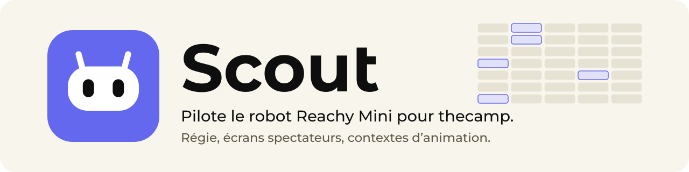
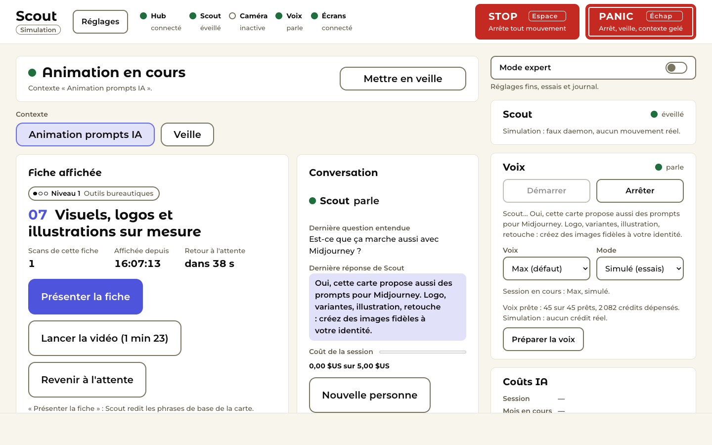
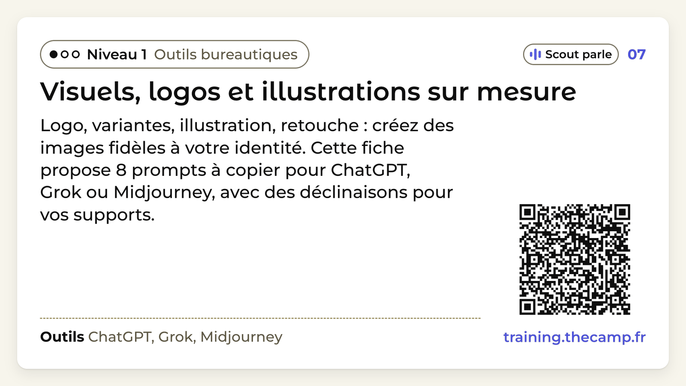
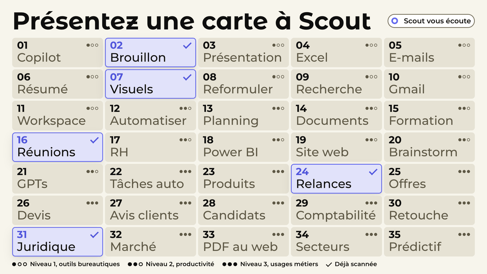

  <picture>
    <source media="(prefers-color-scheme: dark)" srcset="assets/banner-dark.svg">
    <source media="(prefers-color-scheme: light)" srcset="assets/banner-light.svg">
    
  </picture>

Scout pilote le robot Reachy Mini de thecamp : une régie pour l'opérateur et des écrans spectateurs synchronisés, avec un contexte d'activité à la fois. Le premier contexte, « Animation prompts IA », fait réagir le robot quand un visiteur lui montre l'une des 35 cartes à QR code : l'écran affiche la fiche, puis Scout converse sur le sujet.

  

  
  

Captures prises en simulation, sans robot.

## Ce que fait Scout

- **Autonome** : Scout installe et surveille lui-même le pilote du robot ; aucune autre application ni commande.
- **Vivant** : au repos, le robot respire, regarde autour de lui et se tourne vers la voix qui lui parle.
- **Conversation** : réponses courtes et chaleureuses, recherche web pour l'actualité avec des garde-fous, et la carte
  dont on parle s'affiche à l'écran quand on la demande à voix haute.
- **Robuste** : robot débranché, pilote arrêté, réseau coupé : la régie le dit clairement et Scout reprend seul.

## Télécharger

**Scout 2.0.0-rc.3 — révision corrigée 6961d23, macOS Apple Silicon**, signée par thecamp et notarisée par Apple.

- [Télécharger l’application macOS](https://github.com/Nyvek4/scout-releases/releases/download/v2.0.0-rc.3/Scout-macos-arm64-6961d23.zip)
- [Guide utilisateur rapide](GUIDE-UTILISATEUR.md)
- [Notes de version, contrôles et limites connues](https://github.com/Nyvek4/scout-releases/releases/tag/v2.0.0-rc.3)
- [Empreintes SHA-256](https://github.com/Nyvek4/scout-releases/releases/download/v2.0.0-rc.3/SHA256SUMS.txt)

macOS 14 ou plus récent, Mac Apple Silicon. Quittez Scout, dézippez puis copiez Scout.app dans Applications.
Vos réglages et le pilote du robot sont conservés. Saisissez les clés uniquement dans les Réglages de l’application.

## Cette version

La rc.3 renforce l’identité thecamp, pilote The CIRCLE sur une borne externe et anime un Reachy Mini en 3D
sur les écrans publics. Elle reprend le mode salon, les sons et les corrections de la voix de la rc.2.

Cette préversion reste à répéter avec votre robot et vos services avant une démonstration : les notes de version
précisent les essais réalisés et les réserves, notamment la stabilité caméra. Aucun paquet Windows rc.3 n’est fourni.

[Versions précédentes](https://github.com/Nyvek4/scout-releases/releases)
